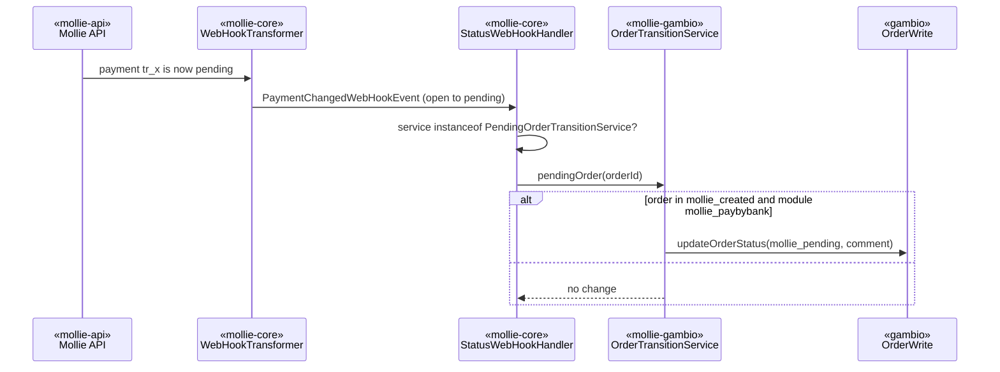

# Plan: Pay by Bank payment method

> **Retroactive.** Written on 2026-11-06 to document the implementation that already exists on
> `feature/CS-8633_5`. It describes the change as built.

## 1. Title + summary

Adds Mollie Pay by Bank as payment module `mollie_paybybank` and puts Pay by Bank orders on hold in a
new "Pending (Mollie)" status while the payment is pending. Realizes `docs/specs/pay-by-bank/spec.md`.

- **Prerequisite:** core release 1.3.12 (`PaymentMethods::PayByBank`, `PendingOrderTransitionService`,
  `pending` in `StatusWebHookHandler`).
- **Target branch:** `4.5-5.x`. Port to `4.1-4.4`: not decided (spec, open decisions).
- **Out of scope:** pending handling for other methods, refund/capture changes.

## 2. Decisions

See `spec.md` § Decisions. Reused mechanisms:
- The payment-module pattern of Wero (`mollie_wero.php`).
- The runtime-upsert approach of `PaymentMethodUpdate` for existing installs (`OrderStatusUpdate`).
- `StatusUpdate::updateStatus()` and `OrderStatusMapper` for the transition.
- `GambioConfigRepository::select/update` (4.5-5.x only) and the CodeIgniter query builder.

## 3. Architecture impact

**Architectural.**
- New core boundary interface `«mollie-core»` `PendingOrderTransitionService`, implemented by
  `«mollie-gambio»` `OrderTransitionService` (core change, released as 1.3.12).
- New wrapper component `OrderStatusUpdate` (runtime status creation) and `DatabaseLock` (shared with
  `docs/specs/payment-status-on-return/`).
- New order status and status-mapping key `mollie_pending` (persistence: `orders_status`,
  `MOLLIE_DEFAULT_ORDER_STATUSES_MAP`, `StatusMapping`).

`DESIGN.md` sections updated in the same pass: §1, §2 (callback interfaces), §3
(`MollieModuleCenterModule`, `OrderStatusMapper`, `OrderTransitionService`, `OrderStatusUpdate`,
`DatabaseLock`, `mollie` base module), §4 (persistence), §5.3, §6, §7 (status keys), §9, §10 (ADR-3).

## 4. Risks & emphasis

| Dimension | Risk | Mitigation |
|---|---|---|
| Security | New code reads only Mollie payloads fetched by the core and Gambio config. No new input from the browser. | Webhook authenticity unchanged (resource fetched back by id). SQL via the query builder (`GambioStatusRepository`, `GambioLanguageRepository`, `DatabaseLock`). |
| Money and state | A late `pending` overwrites `paid` or `canceled`; non-Pay-by-Bank orders move to pending. | `pendingOrder()` updates only when the order is still in `mollie_created` and the module is `mollie_paybybank`. Core compares old and new payment status, so a transition fires once. |
| Backward compatibility | Saved `StatusMapping` and default map lack `mollie_pending`. | `OrderStatusMapper::addMissingStatuses()` adds defaults for missing keys and maps pending to created until the status exists; `pendingOrder()` is a no-op while pending equals created. |
| Compatibility | PHP 5.4 floor; GX 4.5–5.0. | Short arrays, closures with `$this` (5.4), `catch (\Throwable)` is inert on PHP 5. `GET_LOCK` is available in all supported MySQL versions; only one lock per request is held (MySQL < 5.7 releases the previous lock). |
| Performance | `OrderStatusUpdate` runs in every payment-module constructor. | Static guard (once per request) and a cheap `array_diff_key` on a constant; DB writes only when a status is missing. |
| Alignment | Core change vs wrapper workaround. | Core release + vendor update (`PRINCIPLES.md` §5.8); the optional interface keeps other integrations unaffected. |

## 5. Model / flow diagrams

The `instanceof` check keeps the transition optional, so the shared core stays compatible with
integrations that don't implement it.

## 6. Persistence changes

| Store | Change | Migration |
|---|---|---|
| `orders_status` | New status "Pending (Mollie)" (colour `E67E22`), one row per shop language | Install: `_addOrderStatuses()`. Existing install: `OrderStatusUpdate::addMissingStatuses()` |
| `gx_configurations` `configuration/MOLLIE_DEFAULT_ORDER_STATUSES_MAP` | Gains `mollie_pending` | Rewritten by `OrderStatusUpdate` under the `order_status_update` lock, re-read from the DB (the constant can be stale) |
| `mollie_entity` `StatusMapping` | May gain `mollie_pending` when the merchant saves the mapping | None needed; missing key falls back to default |

## 7. Class outline

| Class | Responsibility | Key members |
|---|---|---|
| `mollie_paybybank` (`includes/modules/payment/mollie_paybybank.php`) | Pay by Bank module | `keys()` hides `API_METHOD`; `_getDefaultApi()` returns `API_METHOD_PAYMENT` |
| `Mollie\Gambio\Update\v3_1_6\OrderStatusUpdate` | Creates module statuses missing on an installed shop | `addMissingStatuses(): array` (created IDs by key) |
| `Mollie\Gambio\Utility\DatabaseLock` | MySQL named lock scoped to the shop DB | `__construct($name)`, `static forOrder($orderId)`, `execute($timeout, $callback): bool` |
| `GambioStatusRepository` | Status rows | `createStatus(array $names, $color): int` (names for every language, `en` fallback) |
| `GambioLanguageRepository` | Languages | `getLanguageIdByCode($code): int|null` |
| `OrderStatusMapper` | Mapping | private `addMissingStatuses(array $map, array $defaults)` |
| `OrderTransitionService` | Core callback | implements `PendingOrderTransitionService`; `pendingOrder($orderId, array $metadata)` |
| `MollieModuleCenterModule` | Install | `$defaultStatuses` + `mollie_pending`; `static getDefaultStatuses()` |

No new `BootstrapComponent` registration: `OrderTransitionService` is already registered under
`OrderTransitionService::CLASS_NAME`, and the core checks the extra interface on that instance.

## 8. Files

- New method (pattern as Wero): `includes/modules/payment/mollie_paybybank.php`,
  `lang/*/modules/payment/mollie_paybybank.php` (6), `images/icons/payment/mollie_paybybank.png`.
- Status: `Admin/Classes/MollieModuleCenterModule.inc.php`, `Components/Update/v3_1_6/OrderStatusUpdate.php`,
  `Components/Utility/DatabaseLock.php`, `Components/Entity/Repository/{GambioStatusRepository,GambioLanguageRepository}.php`,
  `Components/Mappers/OrderStatusMapper.php`, `Admin/Html/ConfigSections/mollie_order_statuses.html`,
  `Admin/Classes/Controller/MollieModuleCenterModuleController.inc.php`, `includes/modules/payment/mollie/mollie.php`,
  `Admin/TextPhrases/*/module_center_module.mollie.lang.inc.php` (6).
- Transition: `Components/Services/Business/OrderTransitionService.php`.
- Core: `composer.json`, `composer.lock`, `vendor/` (core 1.3.12).

## 9. Tasks

See `tasks.md`.

## 10. Verification

- `php -l` on the changed PHP files (PHP 8.3 in the test container: no errors).
- PHP 5.4 floor: reviewed by reading; no post-5.4 syntax.
- Vendored core equals core commit `84a4bc9` (`git archive` diff: identical except `tests/`, CI files).
- Manual script on GX 4.5–5.0 (executed on GX 4.9.4.1, 2026-11-06, Mollie test mode):

| Step | Expected | Observed |
|---|---|---|
| Upgrade the files on an installed shop, open checkout | "Pending (Mollie)" created once | Status 154 created |
| Checkout shows Pay by Bank | Method listed | Listed |
| Pay, final state `paid` | Success page, "Paid (Mollie)", confirmation mail | Order 400224: as expected |
| Pay, final state `pending` | Success page, "Pending (Mollie)" with on-hold comment, mail | Order 400225: as expected |
| Pay, final state `open` | Success page, stays "Created (Mollie)", mail | Order 400229: as expected |

- Review sequence `/code-review` → `/simplify` → `/security-review`: not run as skills; a manual code
  review was done on 2026-11-06 (findings in `spec.md` § Open risks).
- Docs updated: `DESIGN.md`.

## 11. Done

Gates green, scenarios above confirmed, `DESIGN.md` in sync. Open: the review skills, the developer's
confirmation of `spec.md`, the port decision and the README note on Riverty manual capture.
