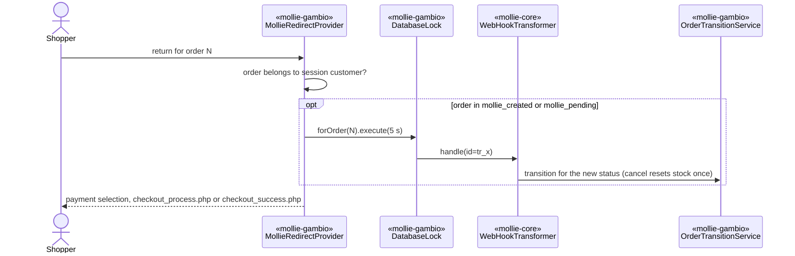

# Plan: payment status check on customer return (PIGAM-229)

> **Retroactive.** Written on 2026-11-06 to document the implementation that already exists on
> `feature/CS-8633_5`. It describes the change as built.

## 1. Title + summary

On return from Mollie, the module applies the current Mollie payment status to the order (through the
webhook code path, serialized with the webhook) before deciding where the shopper goes. Canceled,
failed and expired payments lead back to payment selection; restock happens exactly once in the
cancel transition. Realizes `docs/specs/payment-status-on-return/spec.md`.

- **Target branch:** `4.5-5.x`, ported to `4.1-4.4` in release 2.1.5 (`spec.md` § Port to `4.1-4.4`).
- **Out of scope:** payment links, `RestockService` product-stock logic, admin status changes.
- **Related:** `docs/specs/repeated-order-submit/` later adds a "returned order" session mark to the
  `checkout_process.php` branch of this flow.

## 2. Decisions

See `spec.md` § Decisions. Reused mechanisms: core `WebHookTransformer` (no new sync logic),
`OrderReferenceService`, `OrderStatusMapper`, `OrderResetService`, Gambio `OrderRead`.

## 3. Architecture impact

**Architectural.** Changed flows and a new concurrency mechanism:
- `«mollie-gambio»` `MollieRedirectProvider` now calls `«mollie-core»` `WebHookTransformer` (new
  dependency direction provider → core webhook) and no longer calls `OrderResetService`.
- `«mollie-gambio»` `OrderTransitionService` now owns the order reset for cancel, fail and expiry.
- New `«mollie-gambio»` `DatabaseLock` (MySQL `GET_LOCK`) used by the return and the webhook.
- The return endpoint becomes owner-checked.

`DESIGN.md` updated in the same pass: §2 diagram, §3 (`MollieRedirectProvider`,
`OrderTransitionService`, `OrderReset`, `DatabaseLock`), §5.2, §5.3, §5.6, §7, §8, §10 (ADR-1).

## 4. Risks & emphasis

| Dimension | Risk | Mitigation |
|---|---|---|
| Security | Unauthenticated endpoint triggers state changes or API calls for any order (ASVS 4.5, 8.1). | Ownership check against `$_SESSION['customer_id']` first; unknown or foreign orders go to `account_history.php` without any change. `order_id` is cast to int. The sync calls Mollie with the merchant key for the stored `tr_` id only (no request-controlled id). Logs contain the order id and exception message, no PII. |
| Money and state | The return and the webhook apply the same transition twice (double restock). | Per-order lock around both; core skips unchanged statuses; `mapToCancelledStatus()` returns early when the order is already canceled (Mollie or Gambio cancel status). |
| Money and state | Sync fails (outage, lock timeout) and a canceled payment finishes the checkout. | Fail-open by decision; warning logged; the webhook corrects the status. Lock timeout 5 s on return, 10 s and HTTP 422 in the webhook (Mollie retries). |
| Backward compatibility | Old orders, old references, Orders API references. | Sync only for references with a Mollie id; the Orders API path is unchanged. No schema or config change. |
| Compatibility | PHP 5.4 floor; MySQL named locks. | Closures and `catch (\Throwable)` are 5.4-safe; one lock per request (MySQL < 5.7 releases the previous lock). |
| Performance | Extra Mollie calls per return. | Only for orders in created/pending; up to the same 2–3 GETs as one webhook. |
| Alignment | Business logic in the entry point. | Controller stays thin; logic in `MollieRedirectProvider` and `OrderTransitionService`; transitions through the core. |

## 5. Model / flow diagrams

See `DESIGN.md` §5.2 (return) and §5.3 (webhook), updated in this pass. Short form:

The provider re-reads the order after the sync, so the redirect is decided by the applied status.

## 6. Persistence changes

None. MySQL named locks (`mollie_<db hash>_order_<id>`) are not persisted.

## 7. Class outline

| Class | Responsibility | Key members |
|---|---|---|
| `MollieRedirectProvider` | Decide the return target after syncing the status | `getRedirectUrl($orderId)`, private `_synchronizePaymentStatus()`, `_isCustomerOrder()`, `_isCheckoutOrder()`, `_getCanceledPaymentUrl()` |
| `MollieWebhookController` | Webhook entry | `actionDefault()` runs the transformer inside `DatabaseLock::forOrder(shopReference)` (10 s); 422 when not acquired |
| `OrderTransitionService` | Core callback | private `mapToCancelledStatus()` (idempotent, resets stock), `getGambioCancelStatusId()`, `getComment()` (default language) |
| `DatabaseLock` | Named lock | `forOrder($orderId)`, `execute($timeout, $callback): bool` |
| `MollieTranslator` | Phrases | `__construct($languageId = null)` |
| `GambioLanguageRepository` | Languages | `getLanguageIdByCode($code)` |

## 8. Files

`Components/MollieRedirect/MollieRedirectProvider.php`, `Shop/Classes/Controller/MollieWebhookController.inc.php`,
`Components/Services/Business/OrderTransitionService.php`, `Components/Utility/DatabaseLock.php`,
`Components/Utility/MollieTranslator.php`, `Components/Entity/Repository/GambioLanguageRepository.php`,
`Admin/TextPhrases/*/module_center_module.mollie.lang.inc.php` (6; `order_cancel_error` phrases replaced
by `mollie.payment.redirect.payment_not_completed.description`).

## 9. Tasks

See `tasks.md`.

## 10. Verification

- `php -l` on the changed PHP files (PHP 8.3: no errors). PHP 5.4 floor reviewed by reading.
- Manual script (executed on GX 4.9.4.1, 2026-11-06, Mollie test mode, Pay by Bank):

| Step | Expected | Observed |
|---|---|---|
| Final state `canceled` | Payment selection with "not completed" message; status 99 at return; no mail; combi stock restored once | Order 400226: as expected |
| Final state `failed` | Same, failed comment | Order 400227: as expected |
| Final state `expired` | Same, expired comment | Order 400228: as expected |
| Final state `paid` / `pending` | Status already set when the success page shows; one mail | Orders 400224 / 400225: as expected |
| Wait 20 s for the webhook after each case | No second history entry, no second restock | No change in any case |
| Anonymous visitor calls the return URL of order 400221 | Login page, status unchanged | As expected |
| Customer calls the return URL of another customer's order (400219) | `account_history.php`, status unchanged | As expected |
| Customer calls the return URL of an own old order (400221) | `checkout_success.php`, checkout not finished, status unchanged | As expected |

- Observed outside the scope: the product stock (not the combination stock) is not restored for a
  product with combinations in global stock mode. Pre-existing `RestockService` defect, details in
  `spec.md` § Known pre-existing defect; tracked in a separate ticket.
- Review sequence: not run as skills; manual review on 2026-11-06 (see `spec.md` § Open risks).
- Docs updated: `DESIGN.md`.

## 11. Done

Gates green, scenarios confirmed, `DESIGN.md` in sync. Open: review skills, spec confirmation
(including fail-open), port decision.
