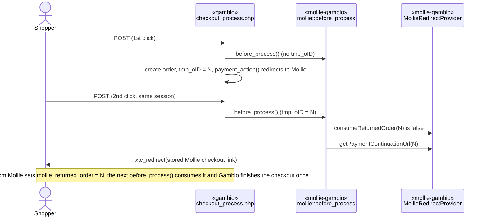

# Plan: repeated order submit (double click) finishes the checkout (CS-8633)

> **Retroactive.** Written on 2026-11-06 to document the implementation that already exists on
> `feature/CS-8633_5`. It describes the change as built.

## 1. Title + summary

`mollie::before_process()` lets Gambio finish the checkout of an existing order only right after the
shopper returned from Mollie. Any other submit is redirected to continue the existing payment.
Realizes `docs/specs/repeated-order-submit/spec.md`.

- **Prerequisite:** `docs/specs/payment-status-on-return/` (the return decides by the synced status
  and sends only the current checkout order to `checkout_process.php`).
- **Target branch:** `4.5-5.x`. Port to `4.1-4.4`: not decided.
- **Out of scope:** Gambio/theme changes, non-locking session handlers.

## 2. Decisions

See `spec.md` § Decisions. Reused mechanisms: Gambio's `before_process()` hook and `tmp_oID`, the
stored `OrderReference` payload (checkout link), the existing `MollieCheckoutRedirect` endpoint.

## 3. Architecture impact

**Architectural** (changed flow): the checkout-finish step now depends on a single-use session mark
set by the return (`«mollie-gambio»` `MollieRedirectProvider`) and checked in `«mollie-gambio»`
`mollie::before_process()` inside `«gambio»` `checkout_process.php`.

`DESIGN.md` updated in the same pass: §3 (`mollie` base module, `MollieRedirectProvider`), §5.1, §5.2,
§7 (session transport), §10 (ADR-2).

## 4. Risks & emphasis

| Dimension | Risk | Mitigation |
|---|---|---|
| Security | Session mark forged or reused. | Set only server-side after the owner check in `getRedirectUrl()`; compared with `tmp_oID`; consumed (unset) on the next `before_process()`. Redirect targets are the stored Mollie link or a shop URL, never request input. |
| Money and state | Legitimate return no longer finishes the checkout; or a repeated submit still does. | Return sets the mark immediately before redirecting to `checkout_process.php`; any submit without the mark is redirected. Residual case: payment creation failed + double click (spec § Open risks). |
| Backward compatibility | Orders API references and orders without a checkout link. | No checkout link → `MollieCheckoutRedirect`, which decides by status. No config or data change. |
| Compatibility | PHP 5.4; GX 4.5–5.0 checkout. | Plain session access and `xtc_redirect`; relies on `before_process()` being called before the `tmp_oID` check (verified on GX 4.9.4.1; to verify on 4.5 and 5.0). |
| Performance | Extra work per submit. | One `OrderReference` read, only when `tmp_oID` is set. |
| Alignment | Logic in the payment module. | The module only delegates to `MollieRedirectProvider`. |

## 5. Model / flow diagrams

## 6. Persistence changes

None in the DB. New session key `mollie_returned_order` (order id), single use.

## 7. Class outline

| Class | Responsibility | Key members |
|---|---|---|
| `mollie` (`includes/modules/payment/mollie/mollie.php`) | Payment module | `before_process()` redirects unless `tmp_oID` is unset or the returned mark matches it |
| `MollieRedirectProvider` | Return and continuation | `const SESSION_RETURNED_ORDER`, `static consumeReturnedOrder($orderId): bool`, `getPaymentContinuationUrl($orderId): string`, private `_getCheckoutUrl($orderId)` |

## 8. Files

`includes/modules/payment/mollie/mollie.php`, `GXModules/Mollie/Mollie/Components/MollieRedirect/MollieRedirectProvider.php`,
`README.md` (release note, `e7b740b`).

## 9. Tasks

See `tasks.md`.

## 10. Verification

- `php -l` on the changed files (PHP 8.3: no errors). PHP 5.4 floor reviewed by reading.
- Manual script (executed on GX 4.9.4.1, 2026-11-06, Mollie test mode, Pay by Bank):

| Step | Expected | Observed |
|---|---|---|
| Two POSTs of the confirmation form 100 ms apart, same session | One order, both 302 to the same Mollie checkout, no mail | Order 400231: as expected |
| Then pay (`paid`) | Success page, one confirmation mail (2 `emails` rows: customer + merchant) | As expected |
| Reach Mollie, then POST the confirmation form again (Back + resubmit) | 302 to the same Mollie checkout, no new order, no mail | Order 400233: as expected |
| Then cancel | Payment selection with message, canceled status, no mail | As expected |

- Note: a browser-level double `form.submit()` sends only one request (Chrome cancels the first
  navigation), so it does not reproduce the issue. The test uses two HTTP POSTs with the session cookie.
- Not run: payment creation failure + double click (spec § Open risks), and a control run on 3.1.5.
- Review sequence: not run as skills; manual review on 2026-11-06.
- Docs updated: `DESIGN.md`.

## 11. Done

Gates green, scenarios confirmed, `DESIGN.md` in sync. Open: review skills, spec confirmation, the
payment-creation-failure case, verification on GX 4.5 and 5.0, port decision.
